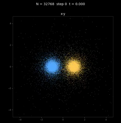

# The N-Body Shop 登戸浦支店

<small>葛飾北斎『冨嶽三十六景 登戸浦』、1830 年（天保元年）から 1834 年（天保 5 年）ごろ。
パブリックドメイン（メトロポリタン美術館の所蔵品、<a href="https://commons.wikimedia.org/wiki/File:%E5%86%A8%E5%B6%BD%E4%B8%89%E5%8D%81%E5%85%AD%E6%99%AF_%E7%99%BB%E6%88%B8%E6%B5%A6-Noboto_Bay_(Noboto_no_ura),_from_the_series_Thirty-six_Views_of_Mount_Fuji_(Fugaku_sanj%C5%ABrokkei)_MET_DP141051.jpg">Wikimedia Commons</a> より）</small>

The N-Body Shop 登戸浦支店は、The N-Body Shop にあやかって名付けた、HPC についての情報発信のサイトです。
本家の The N-Body Shop とは、縁もゆかりもありません。N 体計算以外も扱います。

## 結果

MN-Core 2 の実機で計算した結果です。プログラムは、[Open MN-Core 2 SDK](https://nobuto-ura-hpc-hub.github.io/open-mncore2-sdk/)
の MNCL（登戸浦版）で作りました。

<table style="table-layout: fixed; width: 100%;">
<tr><th><a href="results/3body.html">3 体問題</a></th><th><a href="results/solar.html">太陽系</a></th><th><a href="results/plummer-4096.html">4096 粒子の球状星団の衝突</a></th><th><a href="results/plummer-32k.html">32K 粒子の球状星団の衝突</a></th></tr>
<tr><td></td><td></td><td></td><td></td></tr>
</table>

## 記事

- [HPC と分散メモリ（MN-Core 2 の N 体計算の例）](hpc-distributed-memory.md) — 4096 を超える粒子を、どう分けて計算したか

## 関連

- [Open MN-Core 2 SDK](https://nobuto-ura-hpc-hub.github.io/open-mncore2-sdk/)（[GitHub](https://github.com/Nobuto-Ura-HPC-Hub/open-mncore2-sdk)）

## 外部リンク

- [The N-Body Shop](https://nbody.shop/) — 本家の The N-Body Shop。ワシントン大学で生まれた、天体物理学の数値シミュレーションの国際的な共同研究のグループ
- [University of Washington N-Body Shop](https://hpcc.astro.washington.edu/) — The N-Body Shop が生まれた、ワシントン大学のページ
- [The N-Body Shop（GitHub）](https://github.com/N-BodyShop) — 本家が公開しているシミュレーションのコード（ChaNGa、Gasoline など）と解析の道具
