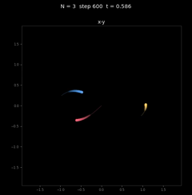
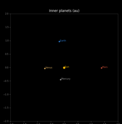
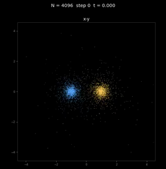

# The N-Body Shop 登戸浦支店

<small>葛飾北斎『冨嶽三十六景 登戸浦』、1830 年（天保元年）から 1834 年（天保 5 年）ごろ。
パブリックドメイン（メトロポリタン美術館の所蔵品、<a href="https://commons.wikimedia.org/wiki/File:%E5%86%A8%E5%B6%BD%E4%B8%89%E5%8D%81%E5%85%AD%E6%99%AF_%E7%99%BB%E6%88%B8%E6%B5%A6-Noboto_Bay_(Noboto_no_ura),_from_the_series_Thirty-six_Views_of_Mount_Fuji_(Fugaku_sanj%C5%ABrokkei)_MET_DP141051.jpg">Wikimedia Commons</a> より）</small>

The N-Body Shop 登戸浦支店は、The N-Body Shop にあやかって名付けた、HPC についての情報発信のサイトです。
本家の The N-Body Shop とは、縁もゆかりもありません。N 体計算以外も扱います。

本家の The N-Body Shop（ワシントン大学）: [Web サイト](https://hpcc.astro.washington.edu/)、[GitHub](https://github.com/N-BodyShop)

## 結果

MN-Core 2 の実機で計算した結果です。プログラムは、[Open MN-Core 2 SDK](https://nobuto-ura-hpc-hub.github.io/open-mncore2-sdk/)
の MNCL（登戸浦版）で作りました。

| [3 体問題](results/3body.md) | [太陽系](results/solar.md) | [4096 粒子の球状星団の衝突](results/plummer-4096.md) | [32K 粒子の球状星団の衝突](results/plummer-32k.md) |
|---|---|---|---|
|  |  |  |  |

## 関連

- [Open MN-Core 2 SDK](https://nobuto-ura-hpc-hub.github.io/open-mncore2-sdk/)（[GitHub](https://github.com/Nobuto-Ura-HPC-Hub/open-mncore2-sdk)）
